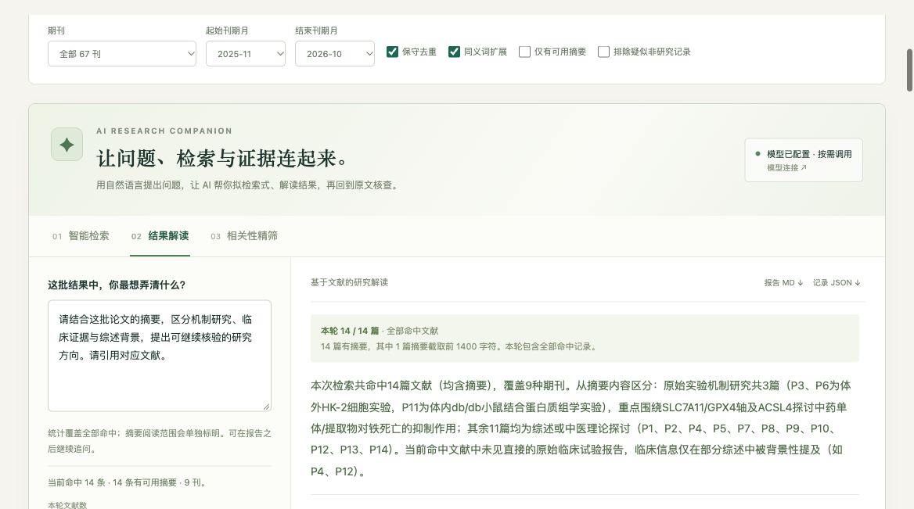

# 岐研 · 中医药文献计量与 AI 研究工作台

本地运行的中医药文献探索工具：布尔检索、关键词排行、共词网络、疾病与方法 / 机制 / 干预交叉矩阵、刊期趋势、文献摘要回查、选刊助手，以及 AI 检索规划、结果解读、相关性初筛和投稿策略。

仓库同时保存应用源码、采集脚本、原始字段元数据快照和整理后语料。快照采集于 **2026-10-29**，应用版本 **v2.1**。



## 数据范围

| 范围 | 记录数 |
| --- | ---: |
| 目标期刊 | 67 刊 |
| 原始全量元数据 | 21,800 |
| 主目录 | 21,709 |
| 提前上线目录，单列 | 18 |
| 增刊，单列 | 73 |
| 默认主目录保守去重后 | 21,686 |
| 默认有可用摘要 | 20,842 |
| 默认有关键词 | 20,859 |

刊期窗口为 **2025-11 至 2026-10**。原快照有 37 个计划期次未返回目录记录；默认趋势仅比较 43 本在这一窗口内常规期次均有记录的期刊。月份由期号与出版周期折算。原始正文摘录、占位符和缺失状态均保留，未伪装为摘要。

## 快速运行

基础功能需要 Python 3.10+，不需要第三方 Python 包。Node.js 仅用于 JavaScript 核验脚本。

```bash
git clone https://github.com/abc1234edawdfasdfewe/qiyan-tcm-research-atlas.git
cd qiyan-tcm-research-atlas

# 从仓库语料生成独立 HTML；生成文件不纳入 Git
python3 build.py --prepared data/corpus.json.gz

# 启动本地服务
python3 ai_server.py
```

在浏览器打开 **http://127.0.0.1:8771/#ai**。macOS 可直接双击 `启动AI工作台.command`，它会在首次运行时自动生成 HTML，并优先打开 Ego Lite。双击 `停止AI服务.command` 可停止本机后台服务。

基础检索与计量可以直接打开生成的 `中医药热点计量工作台.html` 离线使用。AI 功能通过本地 Python 服务调用指定模型，需联网，并在界面的“模型连接”中配置自己的密钥。

## AI 功能

- **智能检索**：自然语言拆解检索概念，生成布尔方案，由本地引擎预检命中数，点击后应用。
- **结果解读**：全量统计与本轮选取的摘要分开标明范围，生成带文献引用的研究方向解释。
- **相关性精筛**：按批判断相关性，核对原文片段，导出标签、理由及文献子集。
- **投稿策略**：对选刊助手当前候选列表前六刊，每刊最多三篇近题论文，分析适配理由、风险和稿件修改方向；须预览字段并勾选同意后调用。

## 选刊助手

打开 **http://127.0.0.1:8771/#journal-fit**。填写题目、摘要、关键词，或导入不超过 20 MB 的 DOCX；选择偏重研究方法、对象或均衡匹配后，一次比较 67 刊。此功能独立于话题检索筛选。支持逐刊查看近题摘要、DOI/来源、刊期收录状态和可解释的匹配依据，导出 Markdown 报告与完整 JSON。

本地匹配无需模型。DOCX 在本机 Python 服务内存中解析，不写入文件；仅提取中文题目、摘要和关键词供核对，完整正文不进入 AI 请求。稿件字段不会存入浏览器持久存储、日志或仓库，刷新后清空。主动导出的选刊结果包含本轮稿件字段。

匹配采用词项稀有度、题名/关键词及摘要的不同权重、方法与对象概念，以及每刊最高分近邻和近题数量饱和项。支持区分实体知识图谱与文献计量图谱，疑似综述按题名调权。分数未作概率校准，不表示期刊质量或录用概率；最新稿约、栏目、核心目录、费用及审稿周期需另行核实。详见 [选刊助手说明](选刊助手说明.md)。

内置模型为 `gemini-4-argon-high`，接口为用户指定的服务。密钥仅存入运行内存或本机 macOS 钥匙串；仓库不包含密钥。该模型接口使用 HTTP，调用内容在网络传输中没有 TLS 加密。

AI 解释与相关性标签需回查文献。图表计数由本地算法完成，AI 初筛切换论文清单，不自动改写原始统计范围。当前没有向量语义检索、引文计数、参考文献或可靠的长期突现分析。

## 文件结构

```text
ai_server.py / ai.js / ai.css / ai-panel.html   AI 服务及界面
engine.js / app.js / styles.css               本地检索与计量
journal-engine.js / journal.js / journal.css   本地选刊排序与界面
journal-panel.html / journal_service.py        选刊面板、DOCX解析、AI证据校验
index.template.html / build.py                独立 HTML 构建
terminology.json                              保守同义词与种子实体词典
data/corpus.json.gz                           应用使用的整理后主目录语料
datasets/enriched/                            21,800 条原始字段元数据与质量表
datasets/catalogue/                           目录、采集计划、刊名映射、覆盖状态
collectors/                                  原始采集及结果组装脚本
AI示例/                                       本次真实模型调用的脱密导出
```

完整字段、采集来源与范围见 [数据说明](datasets/README.md)；采集器用法见 [采集脚本说明](collectors/README.md)。

应用操作见 [使用说明](使用说明.md) 和 [AI使用说明](AI使用说明.md)。

## 重建与验证

```bash
# 从完整原始字段快照重新生成整理后语料和 HTML
python3 build.py

# 核对数据哈希、原始范围与应用 ID 集合
python3 verify_datasets.py

# 以下均为离线检查，不调用模型
node verify_engine.cjs
python3 verify_ai.py
node verify_journal.cjs
python3 verify_journal_service.py

# 服务已运行时验证本地 HTTP 边界，不调用模型
python3 verify_local_service.py
```

代码仓库排除了本机运行目录、日志、密钥文件、重复压缩包及内嵌同一语料的生成 HTML。`data/` 和 `datasets/` 中的压缩 JSON 是正常跟踪的数据文件，克隆后即可使用。

数据来源为知网公开元数据接口及《国际中医中药杂志》官网公开元数据；保留论文 ID、DOI、来源链接和质量状态。此仓库的数据快照不包含论文全文。采集器未来是否仍可用取决于来源服务，离线快照可独立分析。
